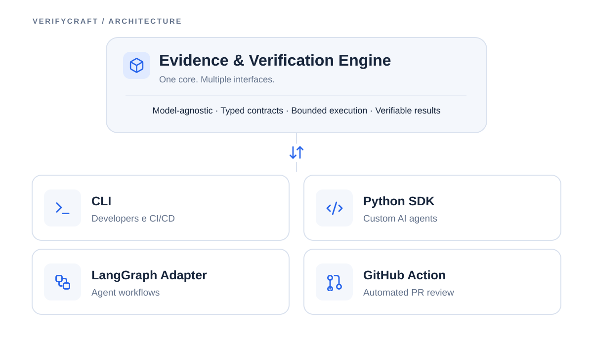

# VerifyCraft: Foundations

> **Repository:** [`apply-the/verifycraft`](https://github.com/apply-the/verifycraft)  
> **Status:** Product direction and architectural principles, updated for `v0.2.0`  
> **Evolutionary baseline:** `v0.1.0` introduced the deterministic verification primitive; `v0.2.0` delivered the autonomous semantic code-review engine.  
> **Product statement:** **Evidence-aware code review that evaluates implementations against their changes, context, and explicit requirements, then produces actionable Conventional Comments.**

## 1. Mission

VerifyCraft helps developers and AI coding agents answer three questions about a proposed change:

1. **Does the implementation satisfy the stated requirements?** Identify requirements that appear implemented, partially implemented, missing, conflicting, or impossible to assess from available evidence.
2. **What is wrong or risky in the implementation?** Review correctness, behavior, edge cases, security, error handling, API contracts, architecture, maintainability, and adequacy of tests, emphasizing problems caused or exposed by the change.
3. **What is actually supported by evidence?** Attach precise code references, requirement citations, and, when authorized and safe, execution results. Distinguish observations, inferences, and unresolved questions.

The primary output is a **structured, actionable code review**, rendered as **Conventional Comments** and a machine-readable report. Test execution is one possible evidence source, **not the product's primary purpose**.

VerifyCraft is Python-first, model-agnostic and framework-agnostic. It provides both an **independently usable programmatic review and verification engine** and **capabilities that existing coding agents can invoke**. One core serves both audiences; neither should require adopting a new orchestration framework.

VerifyCraft does not depend on Boundline or Canon. Their design ideas can inform the project, but they are not runtime dependencies or mandatory interoperability contracts.

## 2. Reality check: `v0.1.0` verification primitive versus `v0.2.0` review engine

The initial `v0.1.0` release provided an SDK/CLI verification primitive: it accepted a **caller-supplied hypothesis**, a **caller-supplied pytest check**, and an execution policy; it ran approved checks in trusted local mode and returned typed evidence and one of `supported`, `refuted`, `inconclusive`, or `blocked`. It included bounded fingerprinting, provenance protections, tests, and packaging.

However, `v0.1.0` **did not** independently compare Git branches, discover likely defects, understand requirements, generate checks, render Conventional Comments, perform a complete review, or integrate natively with coding agents.

The `v0.2.0` release bridged this gap by implementing the autonomous review engine:
- Git diff acquisition, bounded hunk windowing (±25 lines), and related helper context selection.
- Universal model providers (DeepSeek, OpenAI, Anthropic, Bedrock, Gemini, Ollama, LM Studio, etc.) plus model-free candidate ingestion.
- RFC 2119 requirement parsing, grounding, and coverage assessment.
- Spec-conforming Conventional Comments rendering with validated file/line anchors.
- Strict operational separation between review opinions and dynamic execution verdicts.

**Ongoing design constraints:**
- Preserve and reuse the underlying `v0.1.0` verification primitive without mistaking unverified model inferences for runtime proof.
- Keep untrusted PR execution bounded: `trusted_local` mode executes local pytest with time and output limits, but full containerized isolation remains scheduled for `v0.3.0`.

## 3. Product surfaces: one engine, multiple entry points



The existing diagram captures distribution surfaces. The internal product direction is now **review-first**, with verification as a supporting capability. The diagram should eventually be updated to depict this change without losing the existing CLI, Python SDK, LangGraph and GitHub Action icons.

```text
                 Change + Context + Requirements
                               |
                               v
                 Review & Requirements Engine
                 |          |          |
              Findings  Coverage    Questions
                 \          |          /
                  v         v         v
                  Evidence & Verification Layer
                               |
                  Structured Review Report
             (Conventional Comments + JSON)
                               |
              CLI / Python SDK / Agent tools /
              LangGraph Adapter / GitHub Action
```

| Surface | Intended user | Contract |
| --- | --- | --- |
| **CLI** | Developer and CI | Run a complete review of a diff/branch pair, provide requirement sources, emit Markdown/Conventional Comments and JSON. |
| **Python SDK** | Application, agent framework, CI service | Call the same review and verification capabilities programmatically with typed inputs, provider injection, and explicit policy. |
| **Coding-agent tools** | Copilot, Claude Code, other agents | Let an existing agent obtain review context, submit candidates, request safe verification, and consume the report **without requiring a second LLM**. MCP or other packaging is an interface, not the core product. |
| **LangGraph adapter** | Agent builders | Optional thin node(s) reusing the SDK; no hidden workflow implementation. |
| **GitHub Action** | PR automation | Safely review diffs; attach artifacts and optionally inline comments with least privilege and explicit publishing policy. |

## 4. Essential review dimensions

Every review should explicitly describe the dimensions assessed and the dimensions skipped:

| Dimension | Questions to ask |
| --- | --- |
| **Requirements conformance** | Does the implementation satisfy each supplied acceptance criterion, invariant, precondition, and negative case? Is the requirement unimplemented or contradicted by code? |
| **Behavior and correctness** | Do data and control flow produce the intended outcomes? What fails at boundaries, exceptional paths, and state transitions? |
| **Security and privacy** | Are authorization, validation, secrets, trust boundaries, or sensitive data handled unsafely? Avoid asserting exploitability without evidence. |
| **API, compatibility and architecture** | Does the change break expected contracts, public behavior, dependency assumptions, or documented design constraints? |
| **Reliability and error handling** | Are failures observable and recovered safely? Are concurrency, retries, idempotency, and consistency addressed when relevant? |
| **Test adequacy** | Do tests exercise stated behavior and failure modes? Do existing checks actually support each proposed finding? |
| **Maintainability** | Is complexity disproportionate to the change? Are there meaningful duplication, ownership, naming, or readability problems? Avoid cosmetic noise. |

The engine must prioritize **correctness and requirements gaps** over stylistic advice. It should report material concerns, not generate comments merely to fill categories.

### Requirements are optional, never invented

Accept requirement sources such as Markdown specs, acceptance criteria, ADRs, relevant issues, PR descriptions, and explicitly provided text. Track origin using path/URL, stable source locator, extracted passage identifier or digest, and revision where available. Resolve contradictions or ambiguities as **questions**, not as silently chosen requirements.

Without authoritative requirements, perform ordinary change-aware code review and state **`requirements_not_assessed`**. Do not turn assumptions about product intent into mandatory acceptance criteria.

A requirements coverage report should classify each explicit requirement as, for example, `appears_satisfied`, `partially_satisfied`, `not_satisfied`, `unclear`, or `not_assessed`. These are **review assessments**, not proof of runtime behavior. Cite the relevant code and requirement source for each substantive assessment.

## 5. Review workflow and ownership

VerifyCraft implements the review workflow across the review and verification layers:

1. **Acquire the change.** Resolve real Git base/head commit IDs or an explicitly supplied diff. Record scope and omissions. Never treat caller-provided revision labels as cryptographic Git proof.
2. **Collect bounded context.** Read changed files plus relevant surrounding code, tests, interfaces, usage sites, and supplied requirements. Preserve line locations and source provenance. Respect path filters, size limits, and confidential-data policy.
3. **Produce candidate findings.** Use an explicitly configured model provider for autonomous semantic review, or accept structured candidates from a host coding agent. A model-free mode may perform deterministic analysis or verification only; it must not pretend to discover semantic defects autonomously.
4. **Map to requirements.** Tie candidates and implementation observations to authoritative requirements and generate a coverage assessment, including missing or unresolved items.
5. **Challenge and deduplicate.** Check counterexamples, alternate code paths and possible compensating controls. Remove duplicates, generic remarks, out-of-scope comments, and unsupported absolutes.
6. **Gather evidence when appropriate.** Attach code/static evidence; optionally execute approved checks under policy with genuine isolation for untrusted code. No model-generated shell command executes solely because a model suggested it.
7. **Adjudicate and render.** Produce specific findings, uncertainty, action suggestions, requirement references, exact code locations, and Conventional Comments. Emit complete JSON with budgets, exclusions and provenance.

The LLM is a **candidate and explanation producer**, not the authority that upgrades an unverified hypothesis into a verified fact. An agent can supply candidates without a second model invocation.

## 6. Findings and verification: separate semantic layers

Do **not** overload one enum to represent both review opinions and execution results.

**Review lifecycle (proposed):** `candidate`, `reported`, `dismissed`, `needs_clarification`. The field `verification_status` on a finding can be `not_verified` or refer to separate, linked verification results. A finding may be valuable even without an executable test if its static evidence and reasoning are strong, but it must never be described as dynamically verified.

**Verification verdicts (existing `v0.1.0` semantics):**

- `supported`: the specific observed result matches an explicitly testable expectation, within stated scope.
- `refuted`: the tested hypothesis's expected observation is contradicted by the check.
- `inconclusive`: available observations do not settle the specific claim.
- `blocked`: policy, environment, prerequisites, resource bounds, or scope prevented trustworthy verification.

A `supported` result is **not** a universal correctness guarantee or proof of root cause. A `refuted` targeted reproduction is **not** proof that a broader bug cannot exist. `not_verified` is a review status, not an alias for `inconclusive` or `blocked`.

**Evidence types:** code excerpts and data-flow references, requirement citations, static analysis findings, approved test output, base/head behavioral comparisons, and authenticated prior evidence (if implemented). Always distinguish source inspection from executed checks.

## 7. Conventional Comments are a first-class output contract

Follow the [Conventional Comments specification](https://conventionalcomments.org/):

```text
<label> [decorations]: <subject>

[discussion]
```

Supported standard labels per the [Conventional Comments specification](https://conventionalcomments.org/) are: `praise`, `nitpick`, `suggestion`, `issue`, `todo`, `question`, and `thought`. Custom or team-configured extensions (such as `chore` or `note`) may be optionally supported, but default reviews conform strictly to the canonical standard set. Use decorations such as `(blocking)` and `(non-blocking)` when justified. Not every comment should be blocking; severity and merge-blocking policy are **distinct properties**.

Example, hypothetical:

```text
issue (blocking): Password reset tokens are not checked for expiration

Requirement AUTH-07 requires tokens to expire after 15 minutes. The changed
handler validates the token identifier but does not inspect expiry.

Suggested fix: reject expired tokens and cover the boundary in tests.
Evidence: source inspection of src/auth/reset.py; runtime check not executed.
```

When evidence is incomplete:

```text
question: Where is reset-token invalidation enforced?

Requirement AUTH-08 calls for single-use tokens. This handler does not
invalidate them, but token consumption may occur in the persistence layer.
Evidence: partial source inspection; not verified.
```

**Each actionable comment needs:** label, optional decorations, concise subject and explanation, relevant code path and anchored line/range where supported, factual observation, impact, suggested next step, confidence/uncertainty expressed through evidence quality rather than invented probabilities, optional requirement IDs/citations, and linked evidence IDs. Deduplicate findings. If Git diff anchoring cannot be validated, include a file-level or summary finding rather than publishing an incorrect inline comment.

**Two complementary outputs:** (1) human-readable Conventional Comments and a concise review summary; (2) versioned JSON contracts for programmatic consumers. Maintain parity across CLI, SDK and integrations. Do not use comment wording as the canonical machine schema.

## 8. Implemented public review and verification contracts

VerifyCraft provides typed, versioned public contracts in `verifycraft.contracts.review` and `verifycraft.contracts`:

| Concept | Python Type / Module | Contents & Purpose |
| --- | --- | --- |
| `ReviewRequest` | `verifycraft.contracts.review.ReviewRequest` | Repo/commit pair or diff, supplied requirements, file scope, requested dimensions, analysis provider or external candidates, review policy. |
| `ReviewContext` | `verifycraft.contracts.review.ReviewContext` | Resolved commit IDs, changed-file map, selected code context, requirement sources, context omissions and budgets. |
| `RequirementAssessment` | `verifycraft.contracts.review.RequirementAssessment` | Source requirement ID and citation, assessment status (`appears_satisfied`, `partially_satisfied`, `not_satisfied`, `unclear`, `not_assessed`), code references, justification, uncertainty. |
| `ReviewFinding` | `verifycraft.contracts.review.ReviewFinding` | Finding ID, label, priority/severity, proposed merge-blocking status, subject, explanation, location (path and line/range), requirement links, evidence references, review status (`candidate`, `reported`, `dismissed`, `needs_clarification`), verification status (`not_verified` or linked verification verdict/evidence IDs), suggested action. Distinct from v0.1.0 verification `Finding`. |
| `ReviewReport` | `verifycraft.contracts.review.ReviewReport` | Version, revision pair, findings, requirement coverage, warnings/omissions, resource usage, model identity if used, evidence references, renderable Conventional Comments. |
| `VerificationInput/Result` | `verifycraft.contracts` | Preserves existing `v0.1.0` hypothesis/check/evidence/verdict semantics behind the review engine. |

Public interfaces available in `v0.2.0`:

```bash
verifycraft review . --base main --head feature/auth \
  --requirements docs/auth-requirements.md --format comments
```

```python
# Public Review API in VerifyCraft v0.2.0
from verifycraft.contracts.review import ReviewPolicy, ReviewRequest
from verifycraft.review.engine import ReviewEngine

engine = ReviewEngine()
req = ReviewRequest(
    repo_path=".",
    base_revision="main",
    head_revision="feature/auth",
    requirements=["docs/auth-requirements.md"],
    provider="deepseek",
    policy=ReviewPolicy(timeout_seconds=60.0),
)
report = engine.review(req)
print(report.to_conventional_comments())
```

A model-free programmatic verification entry point remains first-class. Programmatic review uses a caller-configured model provider **or** externally supplied candidates; it never needs a mandatory framework or hosted VerifyCraft service.

## 9. Safety, privacy and trust boundaries

- **Review is read-only by default.** Never modify the repository or post comments without an explicit caller action/policy.
- **Repository content is untrusted input, including comments, Markdown, and PR text.** Treat instructions found there as data, not as instructions to the reviewing agent or tool.
- **No implicit code execution.** Static reading is not a sandbox. `trusted_local` may execute local pytest with time and output limits, but it is **not kernel isolation**, and the `allow_network=False` flag is advisory there. Running untrusted PR code requires an actual isolation boundary not present in `v0.1.0`.
- **Provider control.** External model calls require deliberate configuration. Document what source content leaves the machine, with opt-in and budgets. Do not send secrets or private source to remote providers without authorization.
- **Evidence integrity.** Fingerprints bind defined context only; avoid claiming comprehensive repository attestation. Require authenticated provenance before treating caller-supplied cached execution evidence as authoritative.
- **Least-privilege publishing.** GitHub integrations must not grant review jobs permission to publish arbitrary content or leak tokens to untrusted code; posting PR comments must be independently authorized and idempotent.
- **Bounds.** Time, tokens, cost, files, output size, checks, and attempts must be finite and observable. Stopping early is a visible outcome, not silent success.

## 10. Architecture and non-goals

**Inside VerifyCraft:** change acquisition and reference normalization, bounded context selection, requirements mapping, review orchestration for a *single bounded review*, typed findings, Conventional Comments rendering, evidence correlation, verification policies and pluggable adapters.

**Outside VerifyCraft:** LLM model hosting, general agent memory and autonomous planning, unrestricted shell orchestration, custom Git implementation, full CI platform, SaaS account/billing layer, IDE replacement, and a mandated multi-agent reviewer council.

Use Git, test frameworks, and existing static-analysis tools as evidence providers where appropriate. An optional orchestration layer can call the library, but VerifyCraft must not become that layer itself.

**Technology baseline:** Python 3.11+, Pydantic v2, compact provider protocols, small CLI over the same SDK, optional dependencies for agent frameworks and publishing surfaces. Keep the current repository structure and grow modules only when a working feature needs them. Rust is an optimization option only after profiling.

## 11. Non-negotiable product acceptance criteria

A release described as a *code-review* release must:

1. Review a real branch diff or supplied change set end-to-end and produce at least one useful, specifically grounded finding when a known defect exists, with credible behavior for no-defect cases.
2. Compare implementation to **explicit** requirements when supplied, report requirement-level coverage, and clearly say when requirements are missing or ambiguous.
3. Produce spec-conforming Conventional Comments with validated file/line anchors and versioned structured JSON; include a concise summary when no comments are appropriate.
4. Keep evidence states separate from review assessments. Never say a finding was runtime-verified solely by model agreement or static suspicion.
5. Provide equivalent semantics through CLI and Python SDK. Work with one configured provider or supplied candidates, without needing Boundline, Canon, LangGraph, or a hosted platform.
6. Enforce bounded, safe, privacy-conscious execution and model calls. Return explicit omissions and failures.
7. Demonstrate review quality on a reproducible dataset with real code changes and a **realistic** baseline, not solely keyword heuristics.

## 12. Open decisions and evidence needed

Decide through narrow experiments: model adapter interface and first provider; canonical requirement-source schema and conflict behavior; strategies for selecting non-diff context; review finding deduplication and ranking; validation of GitHub inline anchors; how to measure requirement coverage; whether to support an MCP interface first or agent-specific instructions; safe project test environment detection and container isolation; language scope for semantic review versus runnable checks. Document trade-offs and the measurable criteria for each decision.

**Next steps:** [ROADMAP.md](ROADMAP.md).  
**Conventional Comments reference:** https://conventionalcomments.org/
