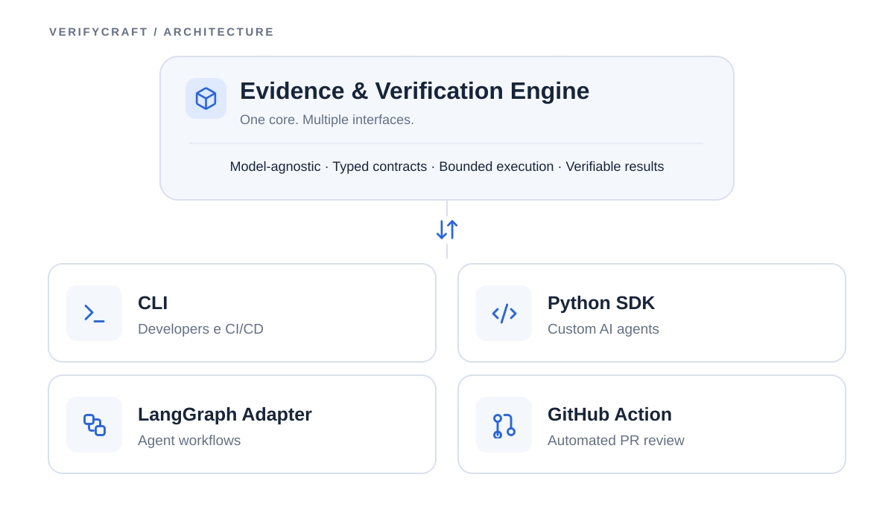

# VerifyCraft: Foundations

> **Working name:** VerifyCraft  
> **Proposed repository:** `apply-the/verifycraft`  
> **Status:** Initial architecture proposal, not an implemented product  
> **Product statement:** Composable review, testing, and verification capabilities for AI agents.

## 1. Mission

Make AI-assisted software engineering **more verifiable without requiring developers to adopt a new agent framework**.

VerifyCraft is a Python-first, framework-agnostic collection of small capabilities. Each capability must be useful **standalone** (Python SDK and CLI) and **embedded** (for example, inside a LangGraph workflow or GitHub automation). It should turn plausible LLM claims into **explicit, inspectable findings backed by reproducible evidence** when evidence can actually be collected.

VerifyCraft is **not** a reimplementation of Boundline or Canon. Their ideas may inform design decisions, but there are no runtime, format, or package dependencies on either project.

## 2. Architecture at a glance



*Diagram source:* [`assets/architecture.svg`](assets/architecture.svg). The SVG uses the same visual icon concepts as the original diagram: **Box**, **Arrow Down Up**, **Terminal**, **Code 2**, **Workflow**, and **Git Pull Request** (Lucide-style line icons).

The center is **one capability engine**, not four implementations. The four interfaces are thin entry points into the same contracts and execution semantics:

| Interface | Who uses it | Responsibility |
| --- | --- | --- |
| **CLI** | Developers and CI/CD | Run a capability locally or in a pipeline; return readable output and machine-readable JSON. |
| **Python SDK** | Custom AI agents and Python apps | Typed programmatic API with dependency injection. |
| **LangGraph Adapter** | Agent workflows | Turn capabilities into graph nodes without making LangGraph a core dependency. |
| **GitHub Action** | Automated PR review | Run bounded analysis on pull requests and publish evidence-backed findings. |

## 3. Core principles

1. **Model-agnostic.** No provider or model is the source of truth. The LLM is an injectable dependency; deterministic evidence checks are separate from model judgment.
2. **Typed contracts.** Inputs, hypotheses, findings, evidence, verdicts, failures, and resource usage have stable schemas. JSON output is versioned.
3. **Bounded execution.** Every operation has configurable caps: time, attempts, model calls, tokens/cost when estimable, test scope, and tool permissions. Exhaustion is an explicit outcome, not an infinite recovery loop.
4. **Verifiable results.** A model's confidence or consensus is not proof. Findings point to test output, static-analysis output, repository locations, and/or reproducible commands. Unsupported claims stay marked as such.
5. **Composition without lock-in.** A single capability can be called directly, used as a Python function, or wired into a third-party workflow. No mandatory session engine, memory store, or agent orchestration.
6. **Small public surface.** A small, predictable interface wins over an ambitious platform. Optional integrations stay outside the core dependency tree.
7. **Safe by default.** Repository inspection is read-only by default. Running generated commands requires an explicit execution policy and isolation appropriate to the environment.
8. **Measurable quality.** New reasoning steps must justify themselves against a simpler baseline on finding quality, reliability, cost, or latency.

## 4. What the product is, and is not

**In scope:**

- Identify narrowly scoped, testable regression hypotheses from code changes.
- Execute approved verification steps and gather evidence.
- Distinguish validated, refuted, inconclusive, and blocked outcomes.
- Expose the same logic through direct usage and thin integrations.
- Gradually grow independent `review`, `test`, and `verify` capabilities.

**Out of scope for the first releases:**

- A general-purpose agent runtime, planner, multi-agent operating system, or workflow DSL.
- Required adoption of LangGraph, LangChain, Canon, or Boundline.
- Autonomous code modification and merging.
- Claims that LLM agreement alone establishes truth.
- A generic security scanner, code-quality platform, or full replacement for existing testing tools.
- Persistent user accounts, a hosted dashboard, or a SaaS control plane.

## 5. Initial technology decisions

| Area | Initial choice | Reason / constraint |
| --- | --- | --- |
| Language | **Python 3.11+** | Integration reach and ecosystem matter more than raw interpreter throughput for an I/O- and model-heavy workload. |
| Repository | One **monorepo**, one installable core package | Keep a single contract and avoid premature micro-repositories. |
| Contracts | **Pydantic v2** models, JSON Schema / JSON serialization | Explicit validation and interoperability. |
| API | Async-capable core, ergonomic synchronous entry point where useful | Supports agent integrations without forcing async on CLI users. |
| CLI | Small CLI over the same SDK entry points | No parallel business logic in CLI commands. |
| Providers | Injected model/tool interfaces; optional provider packages | No mandatory LLM SDK or hosted provider. |
| Testing | `pytest`, contract tests, fixtures, integration tests | Test behavior independently of model prompts. |
| LangGraph | **Optional adapter** | Never a required core dependency. |
| GitHub | **Optional GitHub Action** | Same engine, JSON output, and policy defaults. |
| Rust | Only when profiling identifies a concrete bottleneck | Avoid optimizing hypothetical performance problems. |

All dependencies and version choices should be revisited against actual compatibility needs, not treated as long-term constraints.

## 6. Core abstractions and outcome semantics

**Proposed conceptual contracts** (subject to refinement during the first vertical slice):

| Contract | Minimal content |
| --- | --- |
| `ReviewInput` | Repository path, base/head revision or diff, file filters, verification policy. |
| `Hypothesis` | Claim, affected locations, failure mechanism, proposed evidence path. |
| `VerificationPlan` | Allowed checks, expected observation, prerequisites, resource bounds. |
| `Evidence` | Evidence type, command/check identifier, output digest or excerpt, exit status, revision/diff fingerprint, timestamp. |
| `Finding` | Hypothesis, severity as an estimate, verdict, supporting/contradicting evidence, provenance. |
| `RunResult` | Findings, checks performed, exclusions, errors, usage, duration, and stop reason. |

**Verdicts are evidence statuses, not probabilities:**

- `supported`: the specified check produced evidence consistent with the claim; scope and limitations are recorded.
- `refuted`: available evidence contradicts the specific claim or its proposed reproduction.
- `inconclusive`: the executed checks cannot decide the claim.
- `blocked`: a prerequisite, permission, budget, or safe execution condition prevented verification.

A successful command by itself must **not** make a claim `supported`; the evidence has to match the expected observation. Conversely, a passing test suite is not proof that the entire change is correct. Results become **stale** when their associated repository/diff fingerprint no longer matches.

## 7. Execution and security boundary

The LLM may **propose** a hypothesis or verification step, but must not be able to bypass the execution policy. Before any command runs, the engine checks the command class, working directory, target files, timeouts, and allowed network/file-system access. The first implementation should rely on an explicit allowlist of known test/static-check tools and an isolated workspace or container, not an arbitrary shell command emitted by a model.

Record the revision and tool versions where feasible. Mask known credentials from logs, avoid uploading repository content except through deliberately configured providers, and disable telemetry by default. Never run untrusted PR code directly on a privileged runner without isolation.

## 8. Proposed repository layout

```text
verifycraft/
├── src/verifycraft/
│   ├── contracts/               # Typed, versioned public schemas
│   ├── core/                    # Execution limits, evidence, provenance, policies
│   ├── capabilities/
│   │   ├── verify/             # Initial verification capability
│   │   ├── review/             # Candidate-finding generation
│   │   └── test/               # Targeted test proposal and execution
│   ├── providers/               # Minimal provider protocols
│   └── cli/                     # Direct CLI, same SDK behavior
├── integrations/
│   ├── langgraph/               # Optional graph adapter
│   └── github-action/           # Optional automation wrapper
├── tests/
│   ├── unit/
│   ├── contract/
│   └── integration/
├── benchmarks/                  # Reproducible comparisons against baselines
├── examples/                    # Standalone and embedded usage
├── docs/
└── pyproject.toml
```

This is a **target organization**, not a requirement to create empty directories on day one. A module is created only once a tested use case needs it.

## 9. First narrow use case

**PR regression verification:** given a pull-request diff, the engine forms a small number of testable hypotheses about regressions; for each, it either executes an approved check in a safe environment or explains why a check could not be run. It returns a JSON report with findings, evidence, and explicit verdicts.

The first supported stack should be **Python + pytest**. Other languages, test runners, security analysis, and advanced review strategies are intentionally deferred.

A conceptual user experience (API names are illustrative, not guaranteed):

```python
from verifycraft import VerifyCraft

engine = VerifyCraft(model=my_model_adapter)
result = engine.review(
    repository=".",
    base_ref="origin/main",
    verify=True,
    max_cost_usd=0.50,
)

for finding in result.findings:
    print(finding.verdict, finding.evidence)
```

## 10. Non-negotiable product acceptance criteria

A capability is ready to expose publicly when it:

- Runs with a single SDK call and an equivalent CLI command.
- Returns schema-valid, deterministic **structure** (even when model content differs).
- Has a finite, testable stopping condition with clear error states.
- Does not label an unsupported hypothesis as verified.
- Can replay or inspect the evidence attached to its findings.
- Has unit, contract, and integration tests covering partial failures and resource limits.
- Can be imported without loading optional LangGraph or GitHub dependencies.
- Has at least one reproducible benchmark showing its value versus a simpler baseline.

## 11. Open decisions

The team should resolve these through implementation evidence: the provider interface, the sandbox strategy for local vs CI execution, the precise JSON v1 shape, default cost and time limits, the CLI command vocabulary, and how much verification work belongs in the first MVP. The name and package availability also need final checks before publication.

**Related document:** [ROADMAP.md](ROADMAP.md).
